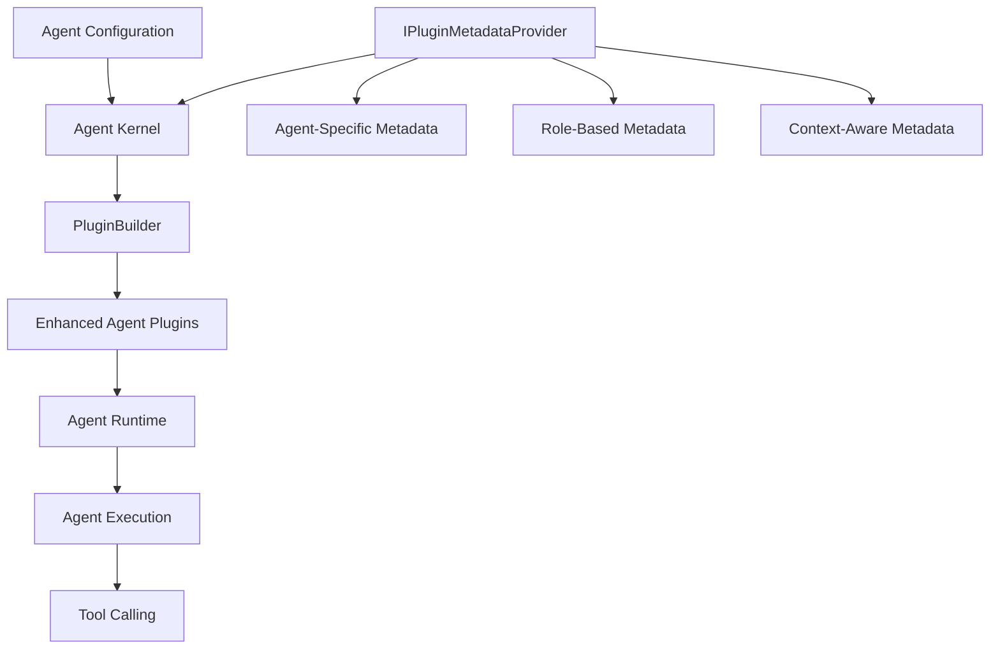

# ADR-0001: Agentic Framework Integration Design

## Status

Proposed

## Context

Microsoft Semantic Kernel recently released an agentic framework that introduces a new paradigm for building autonomous AI agents. These agents can use tools, collaborate with other agents, and execute complex workflows. However, the current framework lacks dynamic metadata customization capabilities for agent plugins.

SemanticPluginForge provides dynamic metadata customization for Semantic Kernel plugins, but it was designed before the agentic framework existed. We need to explore how SemanticPluginForge can be extended to support agent-specific scenarios, including:

- Different agents needing different metadata for the same plugins based on their role
- Runtime modification of agent capabilities without redeployment
- Multi-agent collaboration with specialized tooling per agent
- Context-aware plugin behavior based on agent identity and role

## Decision

We propose extending SemanticPluginForge to support the agentic framework through an agent-aware metadata provider pattern. This document outlines the design for integrating SemanticPluginForge with Microsoft Semantic Kernel's agentic framework, enabling dynamic metadata customization for AI agents and their plugins.

## Overview

The Semantic Kernel agentic framework introduces a new paradigm for building autonomous AI agents that can use tools, collaborate with other agents, and execute complex workflows. SemanticPluginForge can enhance this framework by providing dynamic metadata customization capabilities for agent plugins, enabling runtime configuration of agent behaviors without code changes.

## Agentic Framework Concepts

### Key Components

1. **Agents**: Autonomous AI entities that can reason, make decisions, and execute tasks
2. **Agent Chat**: Conversational interfaces for agents to interact with users and other agents
3. **Agent Plugins**: Tools and capabilities that agents can use to perform actions
4. **Agent Group Chat**: Multi-agent collaboration scenarios
5. **Agent Channels**: Communication mechanisms for agent-to-agent interaction

### Current Agent Plugin Model

In the agentic framework, agents are configured with plugins that define their capabilities:

```csharp
// Current approach (without SemanticPluginForge)
var agent = new ChatCompletionAgent
{
    Instructions = "You are a helpful assistant.",
    Name = "MyAgent",
    Kernel = kernel
};

// Plugins are added to the kernel
kernel.Plugins.AddFromType<WeatherPlugin>();
```

## Integration Design

### Goals

1. **Dynamic Agent Capabilities**: Allow runtime modification of agent plugin metadata without redeploying agents
2. **Agent-Specific Plugins**: Enable different agents to see different metadata for the same plugin based on their name or identity
3. **Simplified Configuration**: Support per-agent plugin configurations using agent name as the primary identifier
4. **Multi-Agent Scenarios**: Facilitate metadata customization in agent group chats and collaboration scenarios

### Architecture



### Proposed API Extensions

#### 1. Agent-Aware Metadata Provider

Extend `IPluginMetadataProvider` to support agent-specific context:

```csharp
public interface IAgentPluginMetadataProvider : IPluginMetadataProvider
{
    /// <summary>
    /// Gets plugin metadata specific to an agent context
    /// </summary>
    PluginMetadata? GetPluginMetadata(KernelPlugin plugin, AgentContext context);
    
    /// <summary>
    /// Gets function metadata specific to an agent context
    /// </summary>
    FunctionMetadata? GetFunctionMetadata(
        KernelPlugin plugin, 
        KernelFunctionMetadata metadata, 
        AgentContext context);
}

public class AgentContext
{
    public string AgentName { get; set; }
    public IDictionary<string, object> Properties { get; set; }
}
```

#### 2. Agent Kernel Builder Extensions

New extension methods for building agent kernels with metadata support:

```csharp
public static class AgentKernelBuilderExtensions
{
    /// <summary>
    /// Creates a kernel for an agent with metadata provider support resolved from DI
    /// </summary>
    public static Kernel BuildForAgent(
        this IKernelBuilder builder,
        string agentName)
    {
        var kernel = builder.Build();
        
        // Register agent context for plugin resolution
        kernel.Data[AgentContextKey] = new AgentContext
        {
            AgentName = agentName
        };
        
        return kernel;
    }
    
    /// <summary>
    /// Creates a kernel for an agent with explicit metadata provider (non-DI scenario)
    /// </summary>
    public static Kernel BuildForAgent(
        this IKernelBuilder builder,
        string agentName,
        IAgentPluginMetadataProvider metadataProvider)
    {
        var kernel = builder.Build();
        
        // Register agent context and metadata provider for plugin resolution
        kernel.Data[AgentContextKey] = new AgentContext
        {
            AgentName = agentName
        };
        kernel.Data[MetadataProviderKey] = metadataProvider;
        
        return kernel;
    }
    
    /// <summary>
    /// Adds plugins to agent kernel with agent-specific metadata
    /// </summary>
    public static IKernelBuilderPlugins AddFromTypeForAgent<T>(
        this IKernelBuilderPlugins plugins,
        AgentContext agentContext,
        string? pluginName = null)
    {
        // Implementation using PluginBuilder with agent context
        // Resolves IAgentPluginMetadataProvider from DI
        return plugins;
    }
}
```

#### 3. Agent Plugin Registration

Simplified registration for agent-specific plugins:

```csharp
// Configure services with metadata provider
services.AddSingleton<IAgentPluginMetadataProvider, RoleBasedMetadataProvider>();

// Build kernel with DI - metadata provider resolved automatically
var kernelBuilder = Kernel.CreateBuilder()
    .AddOpenAIChatCompletion(modelId, apiKey);

var agentKernel = kernelBuilder.BuildForAgent("CustomerSupportAgent");

// Plugins automatically customized based on agent context
agentKernel.Plugins.AddFromTypeForAgent<WeatherPlugin>(
    new AgentContext { AgentName = "CustomerSupportAgent" }
);

var agent = new ChatCompletionAgent
{
    Name = "SupportAgent",
    Instructions = "You help customers with weather information.",
    Kernel = agentKernel
};
```

**Non-DI Scenario** (when dependency injection is not available):

```csharp
var metadataProvider = new RoleBasedMetadataProvider();
var kernelBuilder = Kernel.CreateBuilder()
    .AddOpenAIChatCompletion(modelId, apiKey);

// Pass metadata provider explicitly for non-DI scenarios
var agentKernel = kernelBuilder.BuildForAgent("CustomerSupportAgent", metadataProvider);

agentKernel.Plugins.AddFromTypeForAgent<WeatherPlugin>(
    new AgentContext { AgentName = "CustomerSupportAgent" }
);

var agent = new ChatCompletionAgent
{
    Name = "SupportAgent",
    Instructions = "You help customers with weather information.",
    Kernel = agentKernel
};
```

### Use Cases

#### Use Case 1: Role-Based Plugin Capabilities

Different agents see different function descriptions based on their role:

```csharp
public class RoleBasedMetadataProvider : IAgentPluginMetadataProvider
{
    public FunctionMetadata? GetFunctionMetadata(
        KernelPlugin plugin, 
        KernelFunctionMetadata metadata,
        AgentContext context)
    {
        if (plugin.Name == "WeatherPlugin" && metadata.Name == "GetTemperature")
        {
            // Use agent name to determine capabilities
            return context.AgentName switch
            {
                "CustomerSupportAgent" => new FunctionMetadata(metadata.Name)
                {
                    Description = "Get current temperature for customer's location. Always ask for city first.",
                    Parameters = [
                        new ParameterMetadata("city") 
                        { 
                            Description = "Customer's city name",
                            IsRequired = true 
                        }
                    ]
                },
                "OperationsAgent" => new FunctionMetadata(metadata.Name)
                {
                    Description = "Get temperature data for operational monitoring.",
                    Parameters = [
                        new ParameterMetadata("city") { DefaultValue = "Seattle" },
                        new ParameterMetadata("includeMetrics") { DefaultValue = "true" }
                    ]
                },
                _ => null
            };
        }
        return null;
    }
}
```

#### Use Case 2: Agent Group Chat with Specialized Capabilities

In multi-agent scenarios, each agent has specialized tool access:

```csharp
// Create specialized agents with different plugin views
var weatherAgent = new ChatCompletionAgent
{
    Name = "WeatherExpert",
    Kernel = CreateAgentKernel("WeatherExpert"),
    Instructions = "You are a weather specialist."
};

var travelAgent = new ChatCompletionAgent
{
    Name = "TravelAdvisor",
    Kernel = CreateAgentKernel("TravelAdvisor"),
    Instructions = "You help plan trips."
};

// Same plugin, different metadata per agent
var metadataProvider = new MultiAgentMetadataProvider();

// Weather agent sees detailed meteorological functions
weatherAgent.Kernel.Plugins.AddFromTypeForAgent<WeatherPlugin>(
    new AgentContext { AgentName = "WeatherExpert" }
);

// Travel agent sees simplified travel-focused functions
travelAgent.Kernel.Plugins.AddFromTypeForAgent<WeatherPlugin>(
    new AgentContext { AgentName = "TravelAdvisor" }
);

// Group chat with specialized agents
var groupChat = new AgentGroupChat(weatherAgent, travelAgent);
```

#### Use Case 3: Dynamic Agent Capability Management

Enable/disable agent capabilities dynamically through metadata:

```csharp
public class DynamicCapabilityMetadataProvider : IAgentPluginMetadataProvider
{
    private readonly ICapabilityManager _capabilityManager;
    
    public FunctionMetadata? GetFunctionMetadata(
        KernelPlugin plugin,
        KernelFunctionMetadata metadata,
        AgentContext context)
    {
        // Check if agent has permission for this capability
        if (!_capabilityManager.HasCapability(context.AgentName, $"{plugin.Name}.{metadata.Name}"))
        {
            return new FunctionMetadata(metadata.Name)
            {
                Suppress = true  // Hide function from agent
            };
        }
        
        // Customize based on agent's capability level
        var level = _capabilityManager.GetCapabilityLevel(context.AgentName, plugin.Name);
        return level switch
        {
            "basic" => CreateBasicMetadata(metadata),
            "advanced" => CreateAdvancedMetadata(metadata),
            _ => null
        };
    }
}
```

#### Use Case 4: Agent Channel Integration

Customize plugins for agents communicating through channels:

```csharp
// Agent with channel-specific plugin metadata
var agentChannel = new AgentChannel<ChatCompletionAgent>();

var sender = new ChatCompletionAgent
{
    Name = "SenderAgent",
    Kernel = CreateChannelAgentKernel("SenderAgent", agentChannel.Id)
};

var receiver = new ChatCompletionAgent
{
    Name = "ReceiverAgent",
    Kernel = CreateChannelAgentKernel("ReceiverAgent", agentChannel.Id)
};

// Metadata provider aware of channel context
public class ChannelAwareMetadataProvider : IAgentPluginMetadataProvider
{
    public FunctionMetadata? GetFunctionMetadata(
        KernelPlugin plugin,
        KernelFunctionMetadata metadata,
        AgentContext context)
    {
        // Customize based on agent name or additional properties
        var channelRole = context.Properties?["ChannelRole"] as string;
        
        if (channelRole == "sender" || context.AgentName.Contains("Sender"))
        {
            // Sender agents have send capabilities
            return CreateSenderMetadata(metadata);
        }
        else if (channelRole == "receiver" || context.AgentName.Contains("Receiver"))
        {
            // Receiver agents have receive capabilities
            return CreateReceiverMetadata(metadata);
        }
        
        return null;
    }
}
```

### Implementation Considerations

#### 1. Agent Context Propagation

**Challenge**: How to propagate agent context through the plugin resolution pipeline?

**Solution**: Use Kernel.Data dictionary or a new AgentContext property:

```csharp
public static class KernelExtensions
{
    private const string AgentContextKey = "SemanticPluginForge.AgentContext";
    
    public static void SetAgentContext(this Kernel kernel, AgentContext context)
    {
        kernel.Data[AgentContextKey] = context;
    }
    
    public static AgentContext? GetAgentContext(this Kernel kernel)
    {
        return kernel.Data.TryGetValue(AgentContextKey, out var context) 
            ? context as AgentContext 
            : null;
    }
}
```

#### 2. Performance Optimization

**Challenge**: Metadata resolution for each function call in agent scenarios could impact performance.

**Solution**: Implement caching at the agent level:

```csharp
public class CachedAgentPluginMetadataProvider : IAgentPluginMetadataProvider
{
    private readonly IAgentPluginMetadataProvider _innerProvider;
    private readonly IMemoryCache _cache;
    
    public FunctionMetadata? GetFunctionMetadata(
        KernelPlugin plugin,
        KernelFunctionMetadata metadata,
        AgentContext context)
    {
        var cacheKey = $"{context.AgentName}:{plugin.Name}:{metadata.Name}";
        
        return _cache.GetOrCreate(cacheKey, entry =>
        {
            entry.SlidingExpiration = TimeSpan.FromMinutes(10);
            return _innerProvider.GetFunctionMetadata(plugin, metadata, context);
        });
    }
}
```

#### 3. Agent Lifecycle Management

**Challenge**: When should plugin metadata be refreshed for long-running agents?

**Solution**: Support metadata refresh events:

```csharp
public interface IRefreshableAgentPluginMetadataProvider : IAgentPluginMetadataProvider
{
    event EventHandler<AgentMetadataChangedEventArgs> MetadataChanged;
    
    void RefreshMetadata(string agentName);
}

// Usage in agent management
public class AgentManager
{
    public async Task RefreshAgentCapabilities(string agentName)
    {
        var provider = _serviceProvider.GetService<IRefreshableAgentPluginMetadataProvider>();
        provider?.RefreshMetadata(agentName);
        
        // Rebuild agent's kernel plugins
        await RebuildAgentPlugins(agentName);
    }
}
```

#### 4. Multi-Agent Coordination

**Challenge**: In group chats, how to manage different metadata for different agents?

**Solution**: Agent-scoped kernels with independent metadata resolution:

```csharp
public class AgentGroupChatBuilder
{
    private readonly IAgentPluginMetadataProvider _metadataProvider;
    
    public AgentGroupChat CreateGroupChat(params AgentDefinition[] definitions)
    {
        var agents = definitions.Select(def => 
        {
            var kernel = CreateKernelForAgent(def.Name);
            
            return new ChatCompletionAgent
            {
                Name = def.Name,
                Instructions = def.Instructions,
                Kernel = kernel
            };
        }).ToArray();
        
        return new AgentGroupChat(agents);
    }
    
    private Kernel CreateKernelForAgent(string agentName)
    {
        var builder = Kernel.CreateBuilder();
        // Configure with agent-specific metadata (uses DI)
        var kernel = builder.BuildForAgent(agentName);
        return kernel;
    }
}
```

### Migration Path

For existing SemanticPluginForge users, the migration to agent support is straightforward:

```csharp
// Before: Standard plugin registration
services.AddSingleton<IPluginMetadataProvider, MyMetadataProvider>();
kernelBuilder.Plugins.AddFromTypeWithMetadata<MyPlugin>();

// After: Agent-aware plugin registration (backward compatible)
services.AddSingleton<IAgentPluginMetadataProvider, MyAgentMetadataProvider>();
var agentKernel = kernelBuilder.BuildForAgent("AssistantAgent");
agentKernel.Plugins.AddFromTypeForAgent<MyPlugin>();
```

The existing `IPluginMetadataProvider` interface remains fully supported for non-agent scenarios.

### Testing Strategy

#### Unit Tests

```csharp
[Fact]
public void AgentMetadataProvider_ReturnsAgentSpecificMetadata()
{
    var provider = new RoleBasedMetadataProvider();
    var context = new AgentContext { AgentName = "CustomerSupportAgent" };
    
    var plugin = CreateTestPlugin();
    var metadata = CreateTestMetadata("GetTemperature");
    
    var result = provider.GetFunctionMetadata(plugin, metadata, context);
    
    result.Should().NotBeNull();
    result.Description.Should().Contain("customer");
}
```

#### Integration Tests

```csharp
[Fact]
public async Task AgentWithCustomMetadata_ExecutesFunctionWithCorrectContext()
{
    var metadataProvider = new TestAgentMetadataProvider();
    var kernel = CreateAgentKernel("TestAgent", metadataProvider);
    
    kernel.Plugins.AddFromTypeForAgent<TestPlugin>(
        new AgentContext { AgentName = "TestAgent" }
    );
    
    var agent = new ChatCompletionAgent
    {
        Name = "TestAgent",
        Kernel = kernel
    };
    
    // Execute and verify agent uses customized plugin
    var result = await agent.InvokeAsync("Test the weather plugin");
    
    result.Should().NotBeNull();
}
```

#### Multi-Agent Scenario Tests

```csharp
[Fact]
public async Task AgentGroupChat_EachAgentSeesCustomizedPlugins()
{
    var agent1 = CreateAgentWithName("AgentOne");
    var agent2 = CreateAgentWithName("AgentTwo");
    
    var groupChat = new AgentGroupChat(agent1, agent2);
    
    // Verify each agent has different plugin metadata
    var agent1Functions = agent1.Kernel.Plugins.GetFunctionsMetadata();
    var agent2Functions = agent2.Kernel.Plugins.GetFunctionsMetadata();
    
    agent1Functions.Should().NotBeEquivalentTo(agent2Functions);
}
```

## Benefits

1. **Enhanced Agent Specialization**: Different agents can have specialized views of the same plugins
2. **Runtime Flexibility**: Change agent capabilities without redeployment
3. **Security and Governance**: Control which agents can access which functions
4. **Multi-Agent Coordination**: Enable sophisticated collaboration scenarios with role-based tooling
5. **Simplified Management**: Centralized metadata management for agent fleets

## Future Enhancements

1. **Agent Telemetry Integration**: Track metadata usage per agent for optimization
2. **Visual Agent Designer**: UI tools for configuring agent metadata
3. **Agent Metadata Policies**: Declarative rules for agent capability management
4. **Cross-Agent Learning**: Share successful metadata configurations across agent instances
5. **Agent Plugin Marketplace**: Discover and configure pre-built agent plugins with metadata

## Consequences

### Positive

1. **Enhanced Agent Specialization**: Different agents can have specialized views of the same plugins, enabling more sophisticated multi-agent scenarios
2. **Runtime Flexibility**: Agent capabilities can be changed without redeployment, reducing downtime and enabling dynamic adaptation
3. **Security and Governance**: Fine-grained control over which agents can access which functions improves security posture
4. **Backward Compatibility**: Existing SemanticPluginForge functionality remains fully supported for non-agent scenarios
5. **Natural Extension**: The agent-aware pattern extends naturally from the existing `IPluginMetadataProvider` architecture
6. **Simplified Management**: Centralized metadata management for agent fleets reduces configuration complexity

### Negative

1. **Additional Complexity**: Introduces new concepts (AgentContext, IAgentPluginMetadataProvider) that developers need to learn
2. **Performance Considerations**: Agent context propagation and metadata resolution could impact performance in high-throughput scenarios (mitigated by caching)
3. **Testing Overhead**: Multi-agent scenarios require more comprehensive testing strategies
4. **Migration Effort**: Existing users wanting agent support will need to adopt new APIs

### Neutral

1. **API Surface Expansion**: New interfaces and extension methods increase the overall API surface of the library
2. **Documentation Requirements**: Requires comprehensive documentation of agent-specific features and patterns
3. **Dependency on Semantic Kernel**: Tighter coupling to Semantic Kernel's agentic framework evolution

## Conclusion

Integrating SemanticPluginForge with Semantic Kernel's agentic framework enables powerful new scenarios for building autonomous AI systems. By providing dynamic, context-aware metadata customization, developers can create sophisticated multi-agent applications with fine-grained control over agent capabilities and behaviors.

The proposed design maintains backward compatibility with existing SemanticPluginForge functionality while adding powerful new capabilities for the agentic paradigm. The agent-aware metadata provider pattern extends naturally from the existing architecture, making adoption straightforward for current users.
