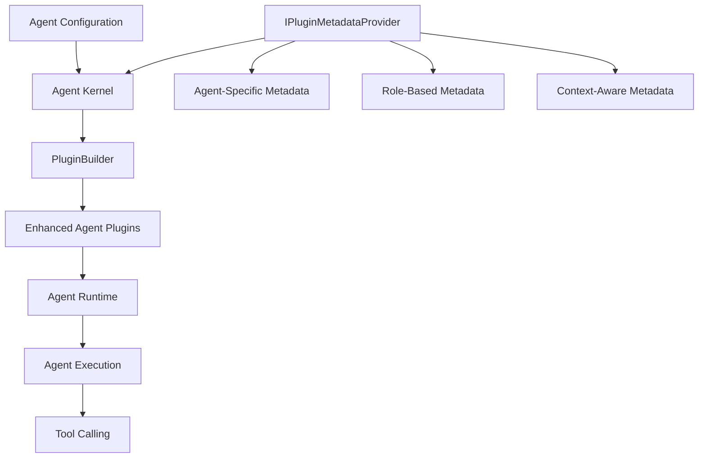

# ADR-0001: Agentic Framework Integration Design

## Status

Proposed

## Context

Microsoft Semantic Kernel recently released an agentic framework that introduces a new paradigm for building autonomous AI agents. These agents can use tools, collaborate with other agents, and execute complex workflows. However, the current framework lacks dynamic metadata customization capabilities for agent plugins.

SemanticPluginForge provides dynamic metadata customization for Semantic Kernel plugins, but it was designed before the agentic framework existed. We need to explore how SemanticPluginForge can be extended to support agent-specific scenarios, including:

- Different agents needing different metadata for the same plugins based on their role
- Runtime modification of agent capabilities without redeployment
- Multi-agent collaboration with specialized tooling per agent
- Context-aware plugin behavior based on agent identity and role

## Decision

We propose extending SemanticPluginForge to support the agentic framework through an agent-aware metadata provider pattern. This document outlines the design for integrating SemanticPluginForge with Microsoft Semantic Kernel's agentic framework, enabling dynamic metadata customization for AI agents and their plugins.

## Overview

The Semantic Kernel agentic framework introduces a new paradigm for building autonomous AI agents that can use tools, collaborate with other agents, and execute complex workflows. SemanticPluginForge can enhance this framework by providing dynamic metadata customization capabilities for agent plugins, enabling runtime configuration of agent behaviors without code changes.

## Agentic Framework Concepts

### Key Components

1. **Agents**: Autonomous AI entities that can reason, make decisions, and execute tasks
2. **Agent Chat**: Conversational interfaces for agents to interact with users and other agents
3. **Agent Plugins**: Tools and capabilities that agents can use to perform actions
4. **Agent Group Chat**: Multi-agent collaboration scenarios
5. **Agent Channels**: Communication mechanisms for agent-to-agent interaction

### Current Agent Plugin Model

In the agentic framework, agents are configured with plugins that define their capabilities:

```csharp
// Current approach (without SemanticPluginForge)
var agent = new ChatCompletionAgent
{
    Instructions = "You are a helpful assistant.",
    Name = "MyAgent",
    Kernel = kernel
};

// Plugins are added to the kernel
kernel.Plugins.AddFromType<WeatherPlugin>();
```

## Integration Design

### Goals

1. **Dynamic Plugin Capabilities**: Allow runtime modification of plugin metadata without redeploying
2. **Context-Aware Plugins**: Enable plugins to have different metadata based on the context in which they're registered (agent, tenant, user, etc.)
3. **Extensible Context**: Support custom context types through `IPluginContext` interface for various scenarios beyond agents
4. **Simplified API**: Context is passed at plugin registration time, eliminating the need for global state or kernel-level context storage

### Architecture



### Proposed API Extensions

#### 1. Plugin Context Interface

Introduce a generic context interface for extensibility:

```csharp
/// <summary>
/// Base interface for plugin context that can carry custom metadata
/// </summary>
public interface IPluginContext
{
    /// <summary>
    /// Custom properties for extensibility
    /// </summary>
    IDictionary<string, object> Properties { get; set; }
}

/// <summary>
/// Agent-specific context implementation
/// </summary>
public class AgentContext : IPluginContext
{
    public string AgentName { get; set; }
    public IDictionary<string, object> Properties { get; set; }
}
```

#### 2. Context-Aware Metadata Provider

Extend `IPluginMetadataProvider` to support context-specific metadata:

```csharp
public interface IContextAwarePluginMetadataProvider : IPluginMetadataProvider
{
    /// <summary>
    /// Gets plugin metadata based on provided context
    /// </summary>
    PluginMetadata? GetPluginMetadata(KernelPlugin plugin, IPluginContext context);
    
    /// <summary>
    /// Gets function metadata based on provided context
    /// </summary>
    FunctionMetadata? GetFunctionMetadata(
        KernelPlugin plugin, 
        KernelFunctionMetadata metadata, 
        IPluginContext context);
}

// Convenience type alias for agent scenarios
public interface IAgentPluginMetadataProvider : IContextAwarePluginMetadataProvider
{
}
```

#### 3. Plugin Registration Extensions

New extension methods for registering plugins with context:

```csharp
public static class ContextAwarePluginExtensions
{
    /// <summary>
    /// Adds plugins with context-aware metadata (DI scenario)
    /// </summary>
    public static IKernelBuilderPlugins AddFromTypeWithContext<T>(
        this IKernelBuilderPlugins plugins,
        IPluginContext context,
        string? pluginName = null)
    {
        plugins.Services.AddSingleton(sp => 
        {
            var metadataProvider = sp.GetRequiredService<IContextAwarePluginMetadataProvider>();
            return CreatePluginWithContext<T>(sp, context, metadataProvider, pluginName);
        });
        
        return plugins;
    }
    
    /// <summary>
    /// Adds plugins with context-aware metadata (non-DI scenario)
    /// </summary>
    public static KernelPlugin AddFromTypeWithContext<T>(
        this ICollection<KernelPlugin> plugins,
        IServiceProvider serviceProvider,
        IPluginContext context,
        IContextAwarePluginMetadataProvider metadataProvider,
        string? pluginName = null)
    {
        var plugin = CreatePluginWithContext<T>(serviceProvider, context, metadataProvider, pluginName);
        plugins.Add(plugin);
        return plugin;
    }
    
    // Convenience methods for agent scenarios
    public static IKernelBuilderPlugins AddFromTypeForAgent<T>(
        this IKernelBuilderPlugins plugins,
        string agentName,
        string? pluginName = null)
    {
        return plugins.AddFromTypeWithContext<T>(
            new AgentContext { AgentName = agentName },
            pluginName
        );
    }
}
```

#### 4. Usage Examples

**DI Scenario** (recommended approach):

```csharp
// Configure services with metadata provider
services.AddSingleton<IContextAwarePluginMetadataProvider, RoleBasedMetadataProvider>();

// Build kernel normally
var kernelBuilder = Kernel.CreateBuilder()
    .AddOpenAIChatCompletion(modelId, apiKey);

// Register plugins with agent context - metadata provider resolved from DI
kernelBuilder.Plugins.AddFromTypeForAgent<WeatherPlugin>("CustomerSupportAgent");

var kernel = kernelBuilder.Build();

var agent = new ChatCompletionAgent
{
    Name = "CustomerSupportAgent",
    Instructions = "You help customers with weather information.",
    Kernel = kernel
};
```

**Non-DI Scenario** (when dependency injection is not available):

```csharp
var metadataProvider = new RoleBasedMetadataProvider();
var kernel = Kernel.CreateBuilder()
    .AddOpenAIChatCompletion(modelId, apiKey)
    .Build();

// Register plugins with explicit metadata provider and context
var agentContext = new AgentContext { AgentName = "CustomerSupportAgent" };
kernel.Plugins.AddFromTypeWithContext<WeatherPlugin>(
    kernel.Services,
    agentContext,
    metadataProvider
);

var agent = new ChatCompletionAgent
{
    Name = "CustomerSupportAgent",
    Instructions = "You help customers with weather information.",
    Kernel = kernel
};
```

**Custom Context Scenario** (using IPluginContext for custom scenarios):

```csharp
// Define custom context
public class TenantContext : IPluginContext
{
    public string TenantId { get; set; }
    public string SubscriptionLevel { get; set; }
    public IDictionary<string, object> Properties { get; set; }
}

// Use custom context
services.AddSingleton<IContextAwarePluginMetadataProvider, TenantAwareMetadataProvider>();

kernelBuilder.Plugins.AddFromTypeWithContext<WeatherPlugin>(
    new TenantContext { TenantId = "tenant-123", SubscriptionLevel = "premium" }
);
```

### Use Cases

#### Use Case 1: Role-Based Plugin Capabilities

Different agents see different function descriptions based on their role:

```csharp
public class RoleBasedMetadataProvider : IAgentPluginMetadataProvider
{
    public FunctionMetadata? GetFunctionMetadata(
        KernelPlugin plugin, 
        KernelFunctionMetadata metadata,
        IPluginContext context)
    {
        if (plugin.Name == "WeatherPlugin" && metadata.Name == "GetTemperature")
        {
            // Use agent name to determine capabilities
            return context.AgentName switch
            {
                "CustomerSupportAgent" => new FunctionMetadata(metadata.Name)
                {
                    Description = "Get current temperature for customer's location. Always ask for city first.",
                    Parameters = [
                        new ParameterMetadata("city") 
                        { 
                            Description = "Customer's city name",
                            IsRequired = true 
                        }
                    ]
                },
                "OperationsAgent" => new FunctionMetadata(metadata.Name)
                {
                    Description = "Get temperature data for operational monitoring.",
                    Parameters = [
                        new ParameterMetadata("city") { DefaultValue = "Seattle" },
                        new ParameterMetadata("includeMetrics") { DefaultValue = "true" }
                    ]
                },
                _ => null
            };
        }
        return null;
    }
}
```

#### Use Case 2: Agent Group Chat with Specialized Capabilities

In multi-agent scenarios, each agent has specialized tool access:

```csharp
// Create specialized agents with different plugin views
var weatherAgent = new ChatCompletionAgent
{
    Name = "WeatherExpert",
    Kernel = CreateAgentKernel("WeatherExpert"),
    Instructions = "You are a weather specialist."
};

var travelAgent = new ChatCompletionAgent
{
    Name = "TravelAdvisor",
    Kernel = CreateAgentKernel("TravelAdvisor"),
    Instructions = "You help plan trips."
};

// Same plugin, different metadata per agent
var metadataProvider = new MultiAgentMetadataProvider();

// Weather agent sees detailed meteorological functions
weatherAgent.Kernel.Plugins.AddFromTypeForAgent<WeatherPlugin>(
    new AgentContext { AgentName = "WeatherExpert" }
);

// Travel agent sees simplified travel-focused functions
travelAgent.Kernel.Plugins.AddFromTypeForAgent<WeatherPlugin>(
    new AgentContext { AgentName = "TravelAdvisor" }
);

// Group chat with specialized agents
var groupChat = new AgentGroupChat(weatherAgent, travelAgent);
```

#### Use Case 3: Dynamic Agent Capability Management

Enable/disable agent capabilities dynamically through metadata:

```csharp
public class DynamicCapabilityMetadataProvider : IAgentPluginMetadataProvider
{
    private readonly ICapabilityManager _capabilityManager;
    
    public FunctionMetadata? GetFunctionMetadata(
        KernelPlugin plugin,
        KernelFunctionMetadata metadata,
        IPluginContext context)
    {
        // Check if agent has permission for this capability
        var agentContext = context as AgentContext;
        if (!_capabilityManager.HasCapability(agentContext.AgentName, $"{plugin.Name}.{metadata.Name}"))
        {
            return new FunctionMetadata(metadata.Name)
            {
                Suppress = true  // Hide function from agent
            };
        }
        
        // Customize based on agent's capability level
        var level = _capabilityManager.GetCapabilityLevel(agentContext.AgentName, plugin.Name);
        return level switch
        {
            "basic" => CreateBasicMetadata(metadata),
            "advanced" => CreateAdvancedMetadata(metadata),
            _ => null
        };
    }
}
```

#### Use Case 4: Agent Channel Integration

Customize plugins for agents communicating through channels:

```csharp
// Agent with channel-specific plugin metadata
var agentChannel = new AgentChannel<ChatCompletionAgent>();

var sender = new ChatCompletionAgent
{
    Name = "SenderAgent",
    Kernel = CreateChannelAgentKernel("SenderAgent", agentChannel.Id)
};

var receiver = new ChatCompletionAgent
{
    Name = "ReceiverAgent",
    Kernel = CreateChannelAgentKernel("ReceiverAgent", agentChannel.Id)
};

// Metadata provider aware of channel context
public class ChannelAwareMetadataProvider : IAgentPluginMetadataProvider
{
    public FunctionMetadata? GetFunctionMetadata(
        KernelPlugin plugin,
        KernelFunctionMetadata metadata,
        IPluginContext context)
    {
        // Customize based on agent name or additional properties
        var agentContext = context as AgentContext;
        var channelRole = context.Properties?["ChannelRole"] as string;
        
        if (channelRole == "sender" || agentContext?.AgentName.Contains("Sender") == true)
        {
            // Sender agents have send capabilities
            return CreateSenderMetadata(metadata);
        }
        else if (channelRole == "receiver" || agentContext?.AgentName.Contains("Receiver") == true)
        {
            // Receiver agents have receive capabilities
            return CreateReceiverMetadata(metadata);
        }
        
        return null;
    }
}
```

### Implementation Considerations

#### 1. Context Passing

**Challenge**: How to pass context to the metadata provider during plugin registration?

**Solution**: Pass context as a parameter during plugin registration. The context is captured at registration time and used when building the plugin:

```csharp
// Context is passed during registration, not stored in kernel
kernelBuilder.Plugins.AddFromTypeForAgent<WeatherPlugin>("CustomerSupportAgent");

// Or with custom context
kernelBuilder.Plugins.AddFromTypeWithContext<WeatherPlugin>(
    new TenantContext { TenantId = "tenant-123" }
);
```

This approach is cleaner as it avoids global state and makes the context explicit at the point of plugin registration.

#### 2. Performance Optimization

**Challenge**: Metadata resolution for each function call in agent scenarios could impact performance.

**Solution**: Implement caching at the agent level:

```csharp
public class CachedAgentPluginMetadataProvider : IAgentPluginMetadataProvider
{
    private readonly IAgentPluginMetadataProvider _innerProvider;
    private readonly IMemoryCache _cache;
    
    public FunctionMetadata? GetFunctionMetadata(
        KernelPlugin plugin,
        KernelFunctionMetadata metadata,
        IPluginContext context)
    {
        var agentContext = context as AgentContext;
        var cacheKey = $"{agentContext?.AgentName}:{plugin.Name}:{metadata.Name}";
        
        return _cache.GetOrCreate(cacheKey, entry =>
        {
            entry.SlidingExpiration = TimeSpan.FromMinutes(10);
            return _innerProvider.GetFunctionMetadata(plugin, metadata, context);
        });
    }
}
```

#### 3. Agent Lifecycle Management

**Challenge**: When should plugin metadata be refreshed for long-running agents?

**Solution**: Support metadata refresh events:

```csharp
public interface IRefreshableAgentPluginMetadataProvider : IAgentPluginMetadataProvider
{
    event EventHandler<AgentMetadataChangedEventArgs> MetadataChanged;
    
    void RefreshMetadata(string agentName);
}

// Usage in agent management
public class AgentManager
{
    public async Task RefreshAgentCapabilities(string agentName)
    {
        var provider = _serviceProvider.GetService<IRefreshableAgentPluginMetadataProvider>();
        provider?.RefreshMetadata(agentName);
        
        // Rebuild agent's kernel plugins
        await RebuildAgentPlugins(agentName);
    }
}
```

#### 4. Multi-Agent Coordination

**Challenge**: In group chats, how to manage different metadata for different agents?

**Solution**: Agent-scoped kernels with independent metadata resolution:

```csharp
public class AgentGroupChatBuilder
{
    private readonly IAgentPluginMetadataProvider _metadataProvider;
    
    public AgentGroupChat CreateGroupChat(params AgentDefinition[] definitions)
    {
        var agents = definitions.Select(def => 
        {
            var kernel = CreateKernelForAgent(def.Name);
            
            return new ChatCompletionAgent
            {
                Name = def.Name,
                Instructions = def.Instructions,
                Kernel = kernel
            };
        }).ToArray();
        
        return new AgentGroupChat(agents);
    }
    
    private Kernel CreateKernelForAgent(string agentName)
    {
        var builder = Kernel.CreateBuilder();
        // Configure with agent-specific metadata (uses DI)
        var kernel = builder.BuildForAgent(agentName);
        return kernel;
    }
}
```

### Migration Path

For existing SemanticPluginForge users, the migration to agent support is straightforward:

```csharp
// Before: Standard plugin registration (context-unaware)
services.AddSingleton<IPluginMetadataProvider, MyMetadataProvider>();
kernelBuilder.Plugins.AddFromTypeWithMetadata<MyPlugin>();

// After: Context-aware plugin registration
services.AddSingleton<IContextAwarePluginMetadataProvider, MyContextAwareProvider>();

// For agents
kernelBuilder.Plugins.AddFromTypeForAgent<MyPlugin>("AssistantAgent");

// For custom contexts
kernelBuilder.Plugins.AddFromTypeWithContext<MyPlugin>(
    new TenantContext { TenantId = "tenant-123" }
);
```

The existing `IPluginMetadataProvider` interface remains fully supported for non-agent scenarios.

### Testing Strategy

#### Unit Tests

```csharp
[Fact]
public void AgentMetadataProvider_ReturnsAgentSpecificMetadata()
{
    var provider = new RoleBasedMetadataProvider();
    var context = new AgentContext { AgentName = "CustomerSupportAgent" };
    
    var plugin = CreateTestPlugin();
    var metadata = CreateTestMetadata("GetTemperature");
    
    var result = provider.GetFunctionMetadata(plugin, metadata, context);
    
    result.Should().NotBeNull();
    result.Description.Should().Contain("customer");
}
```

#### Integration Tests

```csharp
[Fact]
public async Task AgentWithCustomMetadata_ExecutesFunctionWithCorrectContext()
{
    var metadataProvider = new TestAgentMetadataProvider();
    var kernel = CreateAgentKernel("TestAgent", metadataProvider);
    
    kernel.Plugins.AddFromTypeForAgent<TestPlugin>(
        new AgentContext { AgentName = "TestAgent" }
    );
    
    var agent = new ChatCompletionAgent
    {
        Name = "TestAgent",
        Kernel = kernel
    };
    
    // Execute and verify agent uses customized plugin
    var result = await agent.InvokeAsync("Test the weather plugin");
    
    result.Should().NotBeNull();
}
```

#### Multi-Agent Scenario Tests

```csharp
[Fact]
public async Task AgentGroupChat_EachAgentSeesCustomizedPlugins()
{
    var agent1 = CreateAgentWithName("AgentOne");
    var agent2 = CreateAgentWithName("AgentTwo");
    
    var groupChat = new AgentGroupChat(agent1, agent2);
    
    // Verify each agent has different plugin metadata
    var agent1Functions = agent1.Kernel.Plugins.GetFunctionsMetadata();
    var agent2Functions = agent2.Kernel.Plugins.GetFunctionsMetadata();
    
    agent1Functions.Should().NotBeEquivalentTo(agent2Functions);
}
```

## Benefits

1. **Enhanced Agent Specialization**: Different agents can have specialized views of the same plugins
2. **Runtime Flexibility**: Change agent capabilities without redeployment
3. **Security and Governance**: Control which agents can access which functions
4. **Multi-Agent Coordination**: Enable sophisticated collaboration scenarios with role-based tooling
5. **Simplified Management**: Centralized metadata management for agent fleets

## Future Enhancements

1. **Agent Telemetry Integration**: Track metadata usage per agent for optimization
2. **Visual Agent Designer**: UI tools for configuring agent metadata
3. **Agent Metadata Policies**: Declarative rules for agent capability management
4. **Cross-Agent Learning**: Share successful metadata configurations across agent instances
5. **Agent Plugin Marketplace**: Discover and configure pre-built agent plugins with metadata

## Consequences

### Positive

1. **Extensible Design**: `IPluginContext` interface enables custom context types beyond agents (tenants, users, sessions, etc.)
2. **No Global State**: Context is passed at plugin registration, avoiding kernel-level state storage
3. **Runtime Flexibility**: Plugin metadata can be customized based on context without redeployment
4. **Type Safety**: Strongly-typed context objects with intellisense support
5. **Backward Compatibility**: Existing `IPluginMetadataProvider` remains fully supported for context-unaware scenarios
6. **Clear Separation**: Context is explicit at registration time, making the flow easier to understand
7. **Agent Support**: Natural support for agent scenarios through `AgentContext` implementation

### Negative

1. **Additional Complexity**: Introduces new concepts (`IPluginContext`, `IContextAwarePluginMetadataProvider`) that developers need to learn
2. **Plugin Instance Per Context**: Each context creates a new plugin instance, which could increase memory usage in scenarios with many contexts
3. **Testing Overhead**: Context-aware scenarios require more comprehensive testing strategies
4. **Migration Effort**: Existing users wanting context support will need to adopt new interfaces

### Neutral

1. **API Surface Expansion**: New interfaces and extension methods increase the overall API surface of the library
2. **Documentation Requirements**: Requires comprehensive documentation of context-aware features and patterns
3. **Flexibility vs. Simplicity**: More flexible design comes with additional concepts to understand

## Conclusion

The proposed `IPluginContext` interface provides a flexible, extensible foundation for context-aware plugin metadata customization. While designed with Semantic Kernel's agentic framework in mind, the design is general enough to support various scenarios including multi-tenancy, user-specific configurations, and session-based customizations.

Key advantages of this approach:

1. **Simplicity**: Context is passed at plugin registration time, eliminating the need for complex state management
2. **Extensibility**: Custom context types can be created for any scenario by implementing `IPluginContext`
3. **Type Safety**: Strongly-typed context objects provide intellisense and compile-time checking
4. **Backward Compatibility**: Existing `IPluginMetadataProvider` continues to work for context-unaware scenarios

The design maintains the core principles of SemanticPluginForge while extending it to support modern multi-agent and context-aware scenarios. By avoiding global state and keeping context explicit at registration time, the API is cleaner and easier to reason about.
